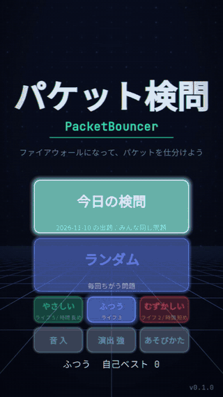
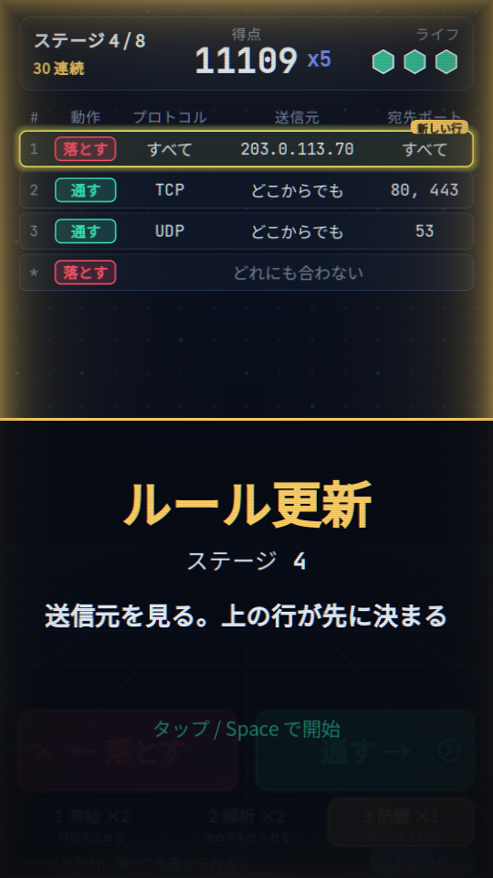
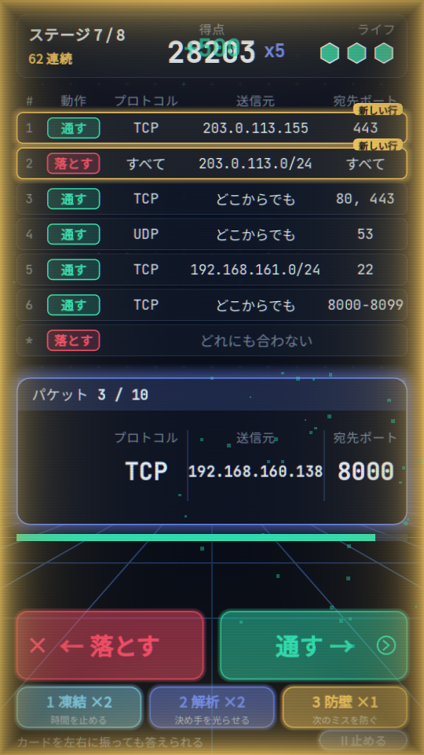
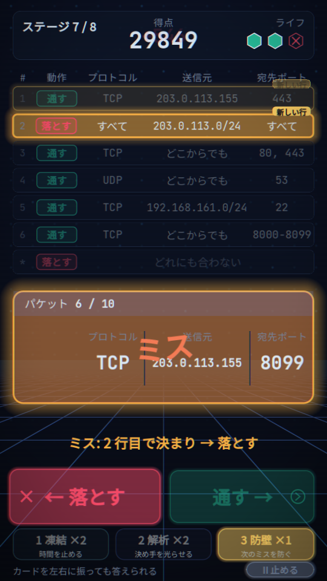
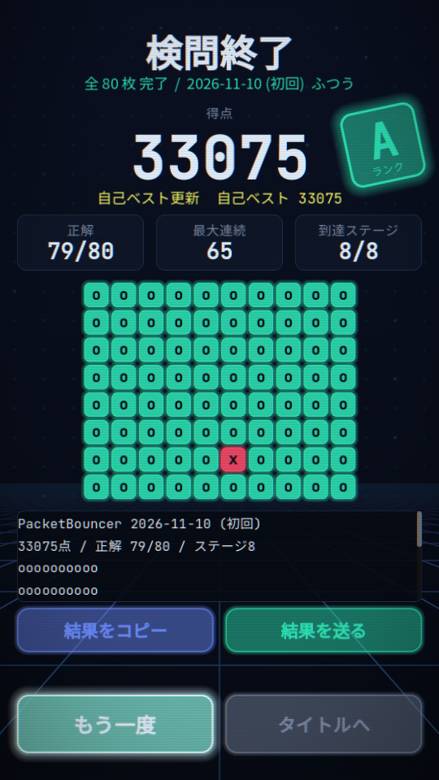

# PacketBouncer(パケット検問ゲーム)

> **開発中です。** 全 8 ステージを遊べますが、制限時間などの調整値はまだ仮の値です(遊んだ人の様子を見て決め直します)。

ブラウザで開くだけで遊べる、1 プレイ 3〜4 分のゲームです。プレイヤーはファイアウォール役になり、1 枚ずつ出てくるパケットを、画面のルール表に従って「通す」か「落とす」かに仕分けます。

**遊ぶ: https://takosasi-dev.github.io/packet-bouncer/**(デスクトップ版の Chrome・Edge・Firefox と、スマホのブラウザ。インストール不要)

<p align="center"></p>

| タイトル | ルール更新 | プレイ中 | ミスしたとき | 結果 |
|---|---|---|---|---|
|  |  |  |  |  |

## ルール

- 画面の上にルール表があり、カードにはパケットのプロトコル・送信元・宛先ポートが書いてあります。表とカードの欄は同じ横位置に並んでいます。
- **表は上から順に見て、最初に合った行で決まります。** どの行にも合わなければ「落とす」です。
- 1 ステージは 10 枚、全 8 ステージ。ステージが進むたびにルールが 1 つずつ増え、「ルール更新」で新しい行が光ります。
- 各ステージの最初の 2 枚は制限時間なし。3 枚目からは下のバーが減り、0 になると時間切れ(ミスと同じ)です。
- ミスするとライフが 1 減り、どの行で決まったのか(例:「2 行目で決まり → 落とす」)が表示されます。ライフ(ふつうは 3 つ)を全部失うか、80 枚を答え終えると結果画面です。
- 連続で当てると倍率が上がります(5 連続ごとに +1、最大 5 倍)。早く答えるほど時間ボーナスが付きます。
- 最大倍率の間は画面の縁が光ります。
- カードの欄のうち薄く表示されている物は、今のルール表のどの行も見ていない欄です。
- 結果画面には正解数でランクが付きます(80 枚全部で S、72 枚以上で A、60 枚以上で B、40 枚以上で C、それより下は D)。

## 難易度

タイトル画面で選びます。変わるのはライフの数と制限時間だけで、ルール表とカードの列は同じです(今日の検問は、どの難易度でもみんな同じ問題)。

| 難易度 | ライフ | 制限時間 |
|---|---|---|
| やさしい | 5 | 1.5 倍 |
| ふつう | 3 | そのまま |
| むずかしい | 2 | 0.7 倍 |

自己ベストは難易度ごとに残ります。

## 技

1 回のプレイで使える回数が決まっています。画面下のボタンか、1・2・3 キーで使います。

| キー | 技 | 回数 | 効果 |
|---|---|---|---|
| 1 | 凍結 | 2 | 今のカードの制限時間を止める(制限時間のあるカードだけ) |
| 2 | 解析 | 2 | 今のカードを決める行を、ルール表で光らせる |
| 3 | 防壁 | 1 | 次のミス 1 回でライフが減らない(連続正解は切れます) |

技を使うと、共有の文字の 2 行目に「/ 技 N回」が付きます。

## 操作方法

| やること | キーボード | マウス・タッチ |
|---|---|---|
| 落とす | ← または A | 「← 落とす」ボタン / カードを左へドラッグして離す |
| 通す | → または D | 「通す →」ボタン / カードを右へドラッグして離す |
| ルール更新を閉じて始める | Space または Enter | 画面の下半分をクリック・タップ |
| 技(凍結・解析・防壁) | 1・2・3 | 画面下の技のボタン |
| 一時停止 / 再開 | Esc または P / Space | 右下の「II 止める」 / 「つづける」 |
| タイトル・結果画面のボタン | Tab・矢印で選んで Enter | クリック・タップ |

- カードのドラッグは、少しだけ動かして離すと元に戻ります(答えにはなりません)。
- スマホは縦向きで遊んでください(横向きにすると案内が出て、ゲームの時間が止まります)。ミスしたときに短く振動します(振動に対応した端末だけ。音を「切」にすると振動もしません)。
- キーを押しっぱなしにしても、答えは 1 回だけです。
- ほかのタブやアプリに移ると、自動で一時停止します。一時停止の間は表とカードを隠します。

## 設定

- **音 入/切**: 効果音(と、スマホの振動)。
- **演出 強/弱**: 「弱」にすると、ミスしたときの画面の揺れと色ずれが止まり、光り方と背景の動きが控えめになります。画面の動きで酔いやすい人向けです。

## 今日の検問とランダム

- **今日の検問**: 端末の日付で問題が決まります。同じ日に遊んだ人は、全員が同じルールと同じカードの列に当たります。
- **ランダム**: 毎回ちがう問題です。
- 結果画面の「結果をコピー」で、得点と 8 × 10 の結果の格子(o = 正解、x = ミス、- = 出なかったカード)を貼り付けられる文字にできます。コピーできないブラウザでは、下の欄の文字を選んでコピーしてください。
- スマホなど共有の仕組みがあるブラウザでは「結果を送る」も出て、LINE や X などに結果の文字を渡せます。
- 自己ベスト(難易度ごと)・選んだ難易度・音の入/切・演出の強弱・今日の検問の回数は、ブラウザの中にだけ保存されます(サーバーには何も送りません。シークレットモードでは残りません)。

## ソースから動かす

[Godot 4.7.2](https://godotengine.org/)(標準版。.NET 版ではない)と、Web の書き出しテンプレートが要ります。

```
godot --headless --path . --import
godot --headless --path . --script res://tests/run_tests.gd
godot --headless --path . --export-release "Web" build/web/index.html
```

- `main` に push すると、GitHub Actions がテスト → Web 書き出し → GitHub Pages への配置を行います(`.github/workflows/pages.yml`)。テストが 1 件でも落ちたら配置しません。
- ブラウザでの確認(窓を出さない Chrome で撮影): `node tests/shoot_web.mjs`(`--play` で 1 ラン、`--perfect` で今日の検問を正しく通して撮る、`--gif` で README の GIF を `docs/images/play.gif` に録る。GIF は ffmpeg を使う)。
- 画面の文言を増やしたら、`pip install fonttools` の後に `python tools/subset_font.py` で同梱フォントを作り直します。
- 効果音は `python tools/gen_sfx.py` で作り直せます(標準ライブラリだけで波形を作っています)。
- URL を貼ったときのプレビュー画像は `python tools/make_og.py` で `docs/images/og.png` を作り直します(Chrome を窓なしで使う)。

## ライセンス

MIT(`LICENSE`)。同梱フォントは SIL Open Font License 1.1 です(`THIRD-PARTY-NOTICES.md`)。
